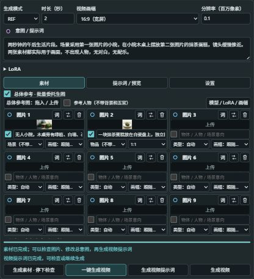
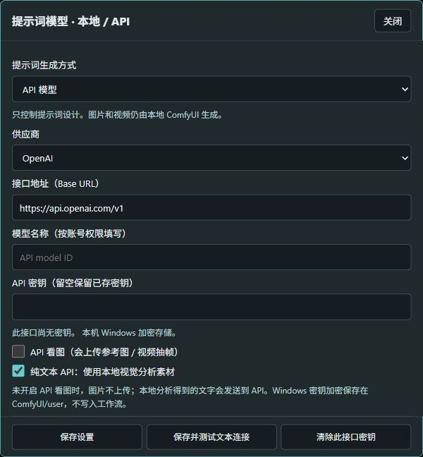

# ComfyUI MiniMax FullStack

[中文介绍](README.zh-CN.md) · [Installation & dependencies](docs/INSTALL.md) · [User manual](docs/MANUAL.en.md) · [API guide](docs/API.md) · [Credits](CREDITS.md)

**From an intent and reference material to a playable video, in one integrated ComfyUI workspace.**

MiniMax H3 Full Stack combines reference management, optional reference-image generation, intent-to-prompt design, H3 video/audio generation, preview, interpolation, upscaling and export. Run the chain in one click, or pause at the image and prompt checkpoints to review and edit.

Its central feature is **reference-aware intent prompting**: describe what you want, and a local vision-language model studies the supplied material and writes an H3 prompt based on MiniMax's official base/reference prompt structure. The optional API backend can handle prompt design instead. Reference labels are checked against the actual material; a reference list is not a substitute for describing its use in the shots.

## What's included

- `MiniMax H3 Full Stack`: compact tabs, Chinese/English UI, image/video/audio references, video LoRAs, editable optimized prompts and native `VIDEO` outputs.
- `H3 Reference Image Generator` / `H3 参考图生图`: an attachable image node with model, aspect, LoRA and prompt controls. One `IMAGE` output can feed multiple reference slots.
- Overall-reference mode: select slots, give each a subject intent and person/object/scene type, generate material, then plan the video from the actual results. Per-slot aspect defaults to the video aspect.
- Local or OpenAI-compatible API prompt design. Explicit opt-in for remote image analysis; keys are not serialized into workflows. No DeepSeek preset or bundled key.
- Reroll images without redesigning a valid prompt just because a LoRA, seed or model changed. Character cards use one three-view composite with an editable template.
- Final-video play/pause and seeking, post-processing stage progress, native Assets registration when enabled, and attached Save Video / Show Text execution.

## Quick start

1. Install into `ComfyUI/custom_nodes/ComfyUI-Minimax-FullStack`, install Python requirements **with ComfyUI's Python**, and install the upstream nodes and weights. Read the [dependency matrix](docs/INSTALL.md): `pip install -r requirements.txt` alone is not a complete installation.
2. Restart the backend and refresh the browser. Add **MiniMax H3 Full Stack**. Existing 2.x workflows are retained; back them up before upgrading.
3. In **Settings → Video Models**, select the H3 model, text encoder and video/audio VAEs. Use a sampling schedule matching your checkpoint/LoRAs.
4. Upload references, enter the intent, and select **Generate video prompt** to inspect it first. Configure **Prompt model · Local / API** in Settings if needed.
5. Select **Generate video**, or use **Generate material · pause for review** / **One-click video** for the overall-reference chain.
6. Look in `output/H3FullStack/`. For native Assets, enable `--enable-assets`, or select **Enable native asset registration** and restart when the queue is empty.

See the [English manual](docs/MANUAL.en.md) or [中文操作手册](docs/MANUAL.zh-CN.md) for connections, prompt reuse and troubleshooting.

## Version 2.9.0

Adds the API prompt backend and fixes final-video delivery. MP4 encoding and Lanczos upscaling process frames incrementally; attached VIDEO outputs are file-backed, so compatible native saves can remux rather than encode the tensor batch again. Encoding/upscaling progress is visible, the base video can be previewed before upscaling completes, and standard saved-file entries are supplied for native Assets.

Validation: **221 Python tests and 86 frontend tests**, plus an actual tiny RIFE → MP4 → Lanczos → attached SaveVideo test with native asset IDs. These checks do not guarantee visual quality, model compatibility, or performance on every device. See [validation scope](docs/VALIDATION.md).

## Scope & privacy

This repository is the Full Stack extension and image helper, **not** a bundled ComfyUI installation, model pack, hosted image/video service, or separate MiniMax Director product. Checkpoints, personal character LoRAs, API keys and user generations are not distributed.

Prompts, diagnostics and workflow media paths can contain private content. Review them before sharing. API text observations also leave the machine, even when image upload is off. See [API privacy](docs/API.md#privacy--隐私).

MIT for this extension; upstream nodes, models and runtimes retain their own licenses. Thanks to MiniMax, Comfy Org and the projects in [CREDITS.md](CREDITS.md).
