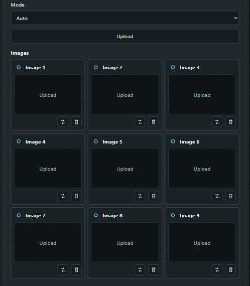
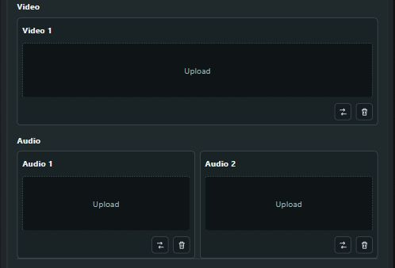
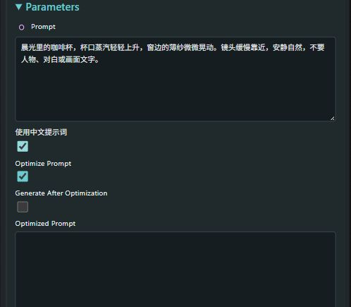
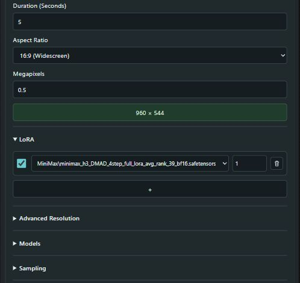

# ComfyUI-Minimax-FullStack

### 从创作意图到视频成片，一个 H3 工作台就够了。

**① 全栈式视频生成。** 在一个面向用户的节点中，完成参考素材导入、模型加载、LoRA 挂载、提示词生成、采样、预览、可选插帧与二次放大，以及视频保存。

**② 不必先写提示词，先说出你的想法。** 本地多模态模型结合你的创作意图、参考素材的内容及排列顺序，依据 H3 官方提示词文档组织画面、动作、镜头、时序与声音，让一个简单想法变成可以检查、复用并交给 H3 的完整生成提示词。

[English](README.md) · [致谢与项目链接](CREDITS.md) · [验收范围](docs/VALIDATION.md) · **2.2.0**

这是独立开发的社区节点，不是 MiniMax 官方产品。它编排已安装的 ComfyUI 节点，并不打包第三方实现或模型权重；提示词优化使用本地模型，不调用云端 LLM API。

## 节点截图

真实 ComfyUI 界面，采用空参考面板和无人物的咖啡视频意图展示；不是新增生成效果或速度基准。









## 核心能力

- **一站式全栈编排：** Auto / T2V / I2V / REF；主模型、文本编码器、视频/音频 VAE；可持续增加的 LoRA；独立采样参数；互斥的注意力后端与可选显存优化；实时预览和可以暂停、拖动的成品播放器。
- **懂意图，也看参考素材：** 例如输入“女孩在街道边玩耍的写真视频”，提供人物照片、街道视频和配饰图片。本地视觉模型接收明确的素材顺序与编号，结合内容推断人物、环境、配饰之间的关系。不需要额外填写 Role；需要指定用途时，直接写在意图里即可。
- **按官方规范组织完整提示词：** 内嵌精简运行契约来自官方 [基础文档](https://huggingface.co/MiniMaxAI/MiniMax-H3/blob/main/docs/VIDEO_PROMPT_WRITING_GUIDE_base_en.md) 与 [参考文档](https://huggingface.co/MiniMaxAI/MiniMax-H3/blob/main/docs/VIDEO_PROMPT_WRITING_GUIDE_ref_en.md) 的结构规范，保留三段/六段字段、素材引用、镜头推进、对白规则、环境声与音乐。结构不完整或引用不存在的素材时会报错，不默默覆盖原输入。
- **先检查，再生成：** 可以只运行提示词优化；确认后点击 **Use Optimized Prompt**，后续生成直接复用，不再调用 LLM。优化结果同时显示在节点内，并通过 STRING 输出口连接文本显示节点。
- **支持中文描述：** 勾选 **使用中文提示词** 后，生成完整中文描述正文。英文协议字段、素材编号、时间标记等保持不变，用户原始对白和画面文字保留原样。要求与英文具有同等内容覆盖，但不保证中英文模型生成效果完全相同。
- **LLM 与视频模型错峰占用显存：** 提示词-only 成功后可以保留 LLM 和视觉投影器，仅清理会话，便于继续优化。进入任何视频路径之前，两者都会通过原生管理器释放，包括关闭优化后复用提示词的情况。优化失败也会清理；若清理未完成，则阻止视频模型加载。
- **支持批量输入与变化：** 九个图片栏分别有 IMAGE 接线口，可连接已安装的 Load Image Batch；提示词可接入 CR Prompt Text 等 STRING 节点。Prompt Variation 根据种子尝试不同的兼容镜头与动作，不保证每次结果都唯一。
- **可选后期与双版本保存：** RIFE 插帧；DLSS 增强或明确标注为非神经的 Lanczos 尺寸放大。二次放大时保存原尺寸和放大尺寸两版视频，并保留生成音轨。

## 安装

1. 使用具有原生 MiniMax H3 支持的 ComfyUI，需包含 H3 条件构建、`CLIPLoader` 的 `minimax` 类型、`MiniMaxH3SigmaShift`、音频解码与 VIDEO 保存接口。
2. 按下面各上游项目的说明安装所需功能依赖。
3. 在 `ComfyUI/custom_nodes` 中执行：

```bash
git clone https://github.com/EnvirCat/ComfyUI-Minimax-FullStack.git
```

4. 等队列完成后重启后端，刷新浏览器，搜索 **MiniMax H3 Full Stack** / `H3FullStack`，或者打开[入门工作流](examples/intent-to-video.json)。

不要与旧版 `ComfyUI-H3-FullStack` 同时加载：两者使用相同的节点 ID 和路由。先备份，再替换旧安装。

### 功能依赖

| 功能 | 所需项目 |
| --- | --- |
| H3 加载、条件构建、采样、注意力选择与保存 | [ComfyUI](https://github.com/Comfy-Org/ComfyUI) 原生 H3 节点 |
| 实时预览、默认低显存注意力与 FF 分块、Sage 选项 | [KJNodes](https://github.com/kijai/ComfyUI-KJNodes)，需相应的 `ModelPreviewOverrideKJ`、`MiniMaxLowVRAMAttention`、`MiniMaxChunkFeedForward` 及所选 Sage 补丁 |
| 本地意图优化 | [ComfyUI-llama-cpp_vlm](https://github.com/lihaoyun6/ComfyUI-llama-cpp_vlm) 的加载器、高级推理节点及原生存储接口，另需兼容的本地 llama.cpp 运行环境 |
| 可选插帧 | [ComfyUI-Frame-Interpolation](https://github.com/Fannovel16/ComfyUI-Frame-Interpolation)：`RIFE VFI` |
| 可选神经增强 | [ComfyUI-DLSS5-Enhancer](https://github.com/Blueforcer/ComfyUI-DLSS5-Enhancer)：`DLSS5EnhanceImages`，以及其支持的运行环境、显卡与驱动 |
| 外部图片、文本和结果显示 | WAS Node Suite、Comfyroll、Custom Scripts，见[致谢](CREDITS.md) |

插件不会自动下载缺少的依赖。默认启用的预览与显存控制需要 KJNodes；不使用时可以关闭。依赖必须提供上述实际 API，不能将任意旧版本都视为兼容。llama.cpp 的 CUDA 等安装请遵循上游说明，不要盲目替换现有 PyTorch 环境。

### 模型位置

- `models/diffusion_models`：T2V/I2V 用匹配的 H3 FL2VA 模型，REF 用 Ref2VA；只有明确支持两种任务的模型才可同时用于两条路径。
- `models/text_encoders`：匹配的 H3 文本编码器。
- `models/vae`：H3 视频 VAE、音频 VAE。
- `models/loras`：兼容的 LoRA，包括可选 DMAD。
- `models/LLM`：本地 instruct GGUF；读取图片还需要与之匹配的视觉 `mmproj`。选择匹配的 Chat Template；普通文本模型不等于视觉模型。
- `models/vae_approx`：使用实时预览时所需的 tiny VAE。

权重不随插件附带，也不会自动下载。请从各发布者获取并遵守各自许可。

## 使用方法

从上到下是 **References → Parameters → Preview**。

References 固定展开，九张图片为 3×3 九宫格，视频为一个可见面板，音频为两个面板。支持拖拽、点击和一次多选上传，按选择顺序填入空栏；替换与删除为紧凑图标。T2V 将素材变暗并忽略，但不清空；I2V 仅启用前两个图片框，作为首帧/尾帧。Auto 在无有效素材时选 T2V，有素材时选 REF。

Parameters 将常改的意图/提示词、语言与优化开关、可检查的优化结果、**Duration (Seconds)**、**Aspect Ratio**、**Megapixels** 和 LoRA 前置，其余模型、采样、加速、LLM 和输出选项位于后面的折叠组。Preview 可显示采样过程，完成后切换到带原生播放、暂停、进度条的 MP4；两版视频共用一个播放区域。

### 先生成提示词，检查后再生视频

1. 输入意图，放入需要的素材，开启 **Optimize Prompt**。
2. 关闭 **Generate After Optimization**：这次只生成提示词。需要一口气完成视频时则保持开启。
3. 查看 **Optimized Prompt** 文本框，或将 STRING 输出连接到文本显示节点。
4. 点击 **Use Optimized Prompt**，再次运行。跳过 LLM 推理，并在加载 H3 前释放此前保留的 LLM/投影器。要返回原输入，点击 **Use Input Prompt**；要重写，重新开启优化。

原始本地意图未改变时，直接关闭优化也会自动复用最近结果。修改意图、素材、时长、画幅、模式或语言后取消自动复用，旧文本仍可查看或明确选择。中文开关只影响下一次优化，不会把已有结果自动翻译。

### 时长、分辨率、加速

**Duration** 是目标视频秒数，不是 LLM 生成时间。H3 原生为 24 fps，帧数向上对齐为 `17k + 5`，所以输入 5 秒会得到 124 帧、约 5.167 秒。

**Aspect Ratio** 设置画幅，**Megapixels** 设置面积，**Multiple** 设置对齐倍数（一般 32）；尺寸预览会显示实际宽×高。16 MP 是控件校验上限，不等于 H3 或显卡的可用最大分辨率。建议从小尺寸开始，遵循模型公布的尺寸范围与实际显存限制。

DMAD 属于普通 **LoRA**，可单独设置权重；**Steps**、采样器和调度器独立，请遵循所用 LoRA/主模型的建议。一次只能选择一个注意力后端；Low VRAM 与 FF 分块是独立显存选项。Sage/Sol 依赖内核和硬件，无法使用时会报错，不偷偷替换算法。

优化器默认上下文 8192、最大输出 1536 tokens、温度 0.65、关闭 thinking，并限制视觉采样数量。测试用的 Qwen-VL 路径为每个视觉样本预留 1024 tokens。素材较多时可能需要增大上下文；输出截断时需提高 Max Tokens。只有参数匹配的提示词-only 成功任务才复用热模型，生视频前仍执行释放。

### 输出与保存

三个输出口：**Video**（VIDEO）、**Upscaled Video**（VIDEO）、**Optimized Prompt**（STRING）。只优化提示词时，两条视频分支会被干净阻断；不放大时阻断第二条分支，不向 Save Video 传递 None。

节点会自行保存视频。**Output Directory** 默认相对 ComfyUI 的输出目录，也可选择绝对路径；**Filename** 是文件名前缀。文件名带时间、随机后缀和种子，避免覆盖。开启二次放大后生成 `_base.mp4` 与 `_upscaled.mp4`；放大失败时已保存的原视频仍保留。额外接 Save Video 会产生额外副本。

提示词/生成记录保存在本地，包含意图与参考映射。工作流属性也可能保存提示词和结果路径，分享前请检查。上传素材保留在本机；删除卡片不会删除源文件。上传和文件接口设计用于本机回环访问，不适合作为公共托管服务。

## 需要说清的边界

优化器读取参考图片和每个视频抽取的三帧，不是逐帧理解整个视频。音频目前只提供编号与元数据映射；优化器不会听音频、转录对白或猜测声线，H3 生成本身可以接收启用的音频参考。人物合并、用途推断和参考遵循仍可能出错，建议检查后再跑昂贵批量。

内嵌文档是依据官方规范维护的精简运行指令，不等同于官方托管的上下文处理服务或 Context-IR 模型，也没有逐字转载完整官方文档。提示词质量取决于本地模型；更大上下文、长视频与高分辨率可能耗尽显存。中英文按同等内容要求生成，不承诺完全相同的画质。

## 验收与致谢

2.2.0 的 **41 项 Python 离线测试、16 项前端行为测试通过**。本轮中文与生命周期更新没有排入新的 GPU 生成任务，不宣称已做中英文视频画质对比。历史功能冒烟测试和未测组合见[验收说明](docs/VALIDATION.md)。

感谢 MiniMax、ComfyUI 和所有相关节点作者，完整名称、用途和链接见 [CREDITS.md](CREDITS.md)。本仓库原创扩展代码采用 MIT 许可；第三方节点、内核、模型与文档分别遵守原许可，不代表官方背书。
